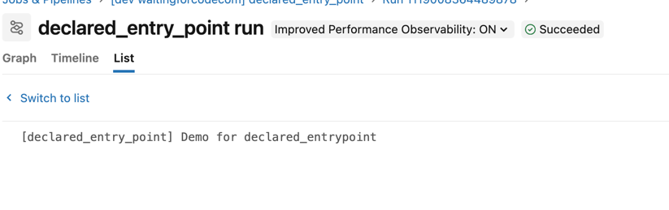
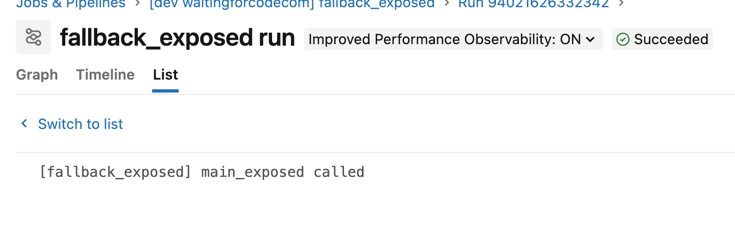
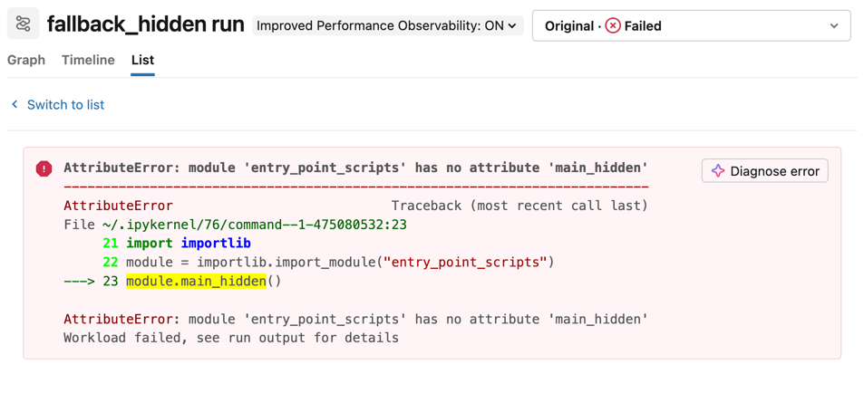

# Entry point scripts vs `__all__` demo

## Prerequisites
1. Configure your Databricks workspace, if you haven't done it yet:
```shell
databricks configure
```

Set your workspace host in [databricks.yml](databricks.yml)

2. No manual setup is needed: the demo doesn't use any schema, table or volume. All jobs build a tiny DataFrame inline.

3. Deploy the bundle:
```shell
BROWSER="/Applications/Google Chrome.app/Contents/MacOS/Google Chrome" databricks auth login --profile personal_free_wfc 
databricks bundle deploy --target dev --profile personal_free_wfc
```

4. Optionally, check the entry points declared in the wheel metadata. Only `read_tables` should be there:
```shell
unzip -p dist/*.whl '*/entry_points.txt'
```
```
[console_scripts]
read_tables = entry_point_scripts.declared_entry_point:read_tables_main
```

## How the code is organized
* [pyproject.toml](pyproject.toml) declares a single entry point in `[project.scripts]`: `read_tables`.
* [fallback_entry_points.py](src/entry_point_scripts/fallback_entry_points.py) defines two argument-free functions,
`main_exposed` and `main_hidden`
* [\_\_init\_\_.py](src/entry_point_scripts/__init__.py) re-exports the module with `from .fallback_entry_points import *`, but its `__all__` lists only `main_exposed`.

When the `entry_point` of a `python_wheel_task` is missing from the wheel metadata, Databricks falls back to calling
`entry_point_scripts.<entry_point>()` on the package.

## Demo 1 - Entry point declared in `[project.scripts]`
1. Explain the [declared_entry_point.job.yml](resources/declared_entry_point.job.yml). The job uses the script-based entrypoint.
`entry_point: read_tables`.
2. Go to the Jobs on Databricks UI and trigger this job.
3. The job should succeed and you should see:



## Demo 2 - Fallback to a function listed in `__all__`
1. Explain the [fallback_exposed.job.yml](resources/fallback_exposed.job.yml). 
* the job uses `entry_point: main_exposed`,  which is **not** declared in `[project.scripts]` but is 
listed in the `__all__` variable
2. Run the _fallback_exposed_ job.
3. The job should succeed and you should see:



## Demo 3 - Function missing from `__all__`
1. Explain the [fallback_hidden.job.yml](resources/fallback_hidden.job.yml). 
* the job uses `entry_point: main_hidden`. The function takes no arguments and lives in the same module as 
`main_exposed`, but it's declared neither in `[project.scripts]` nor in `__all__`.
2. Run the _fallback_hidden_ job.
3. The job should fail with the `AttributeError` exception:



## Clean-up
```shell
databricks bundle destroy --target dev --profile personal_free_wfc
```
