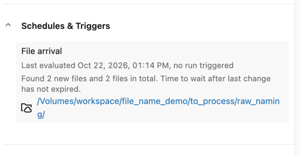
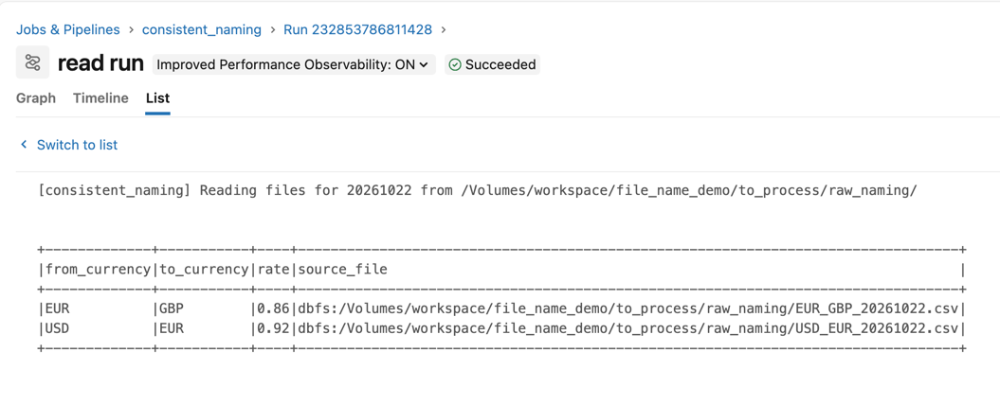
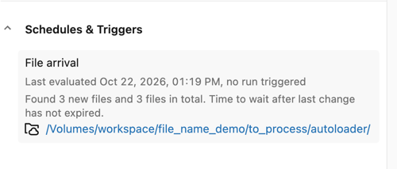
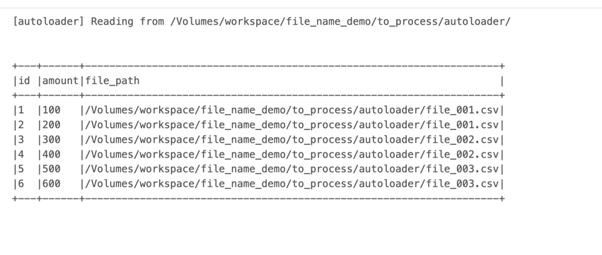
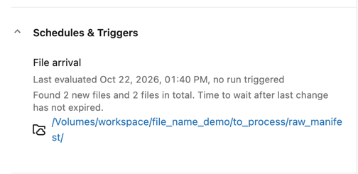
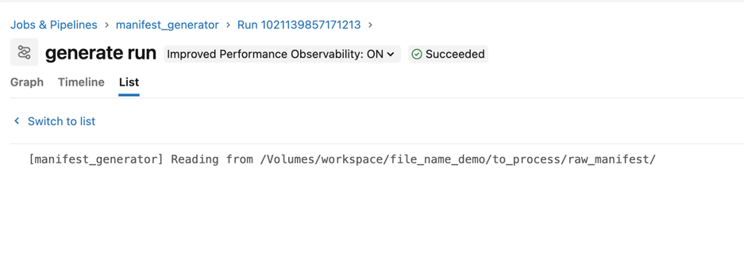
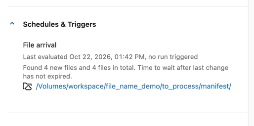
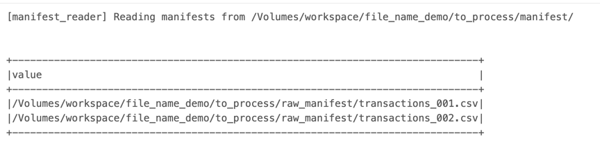

# Reading File Names with Databricks Volume Trigger

## Prerequisites
1. Configure your Databricks workspace, if you haven't done it yet:
```shell
databricks configure
```

Set your workspace host in [databricks.yml](databricks.yml)

2. Create demo table and volume from Databricks SQL Editor:
```sql
USE CATALOG workspace;
CREATE SCHEMA IF NOT EXISTS file_name_demo;
CREATE VOLUME IF NOT EXISTS file_name_demo.to_process;
```

3. Deploy the bundle:
```shell
BROWSER="/Applications/Google Chrome.app/Contents/MacOS/Google Chrome" databricks auth login --profile personal_free_wfc 
databricks bundle deploy --target dev --profile personal_free_wfc
```

## Demo 1 — Consistent naming with date suffix
1. Prepare the input files:
```shell
./write_consistent_naming_files.sh
```
You should see 2 files generated with the current date:
```
tree input_files 
input_files
├── EUR_GBP_20261022.csv
└── USD_EUR_20261022.csv
```

2. Explain [consistent_naming.py](src/file_name_demo/consistent_naming.py)
* the reader doesn't list the volume to discover new files. Instead, it relies on the naming convention shared with
the producer: `<FROM>_<TO>_<YYYYMMDD>.csv`. It converts the `trigger_date` parameter (`2026-10-22`) into the file
suffix (`20261022`), builds the exact path for each currency pair, and reads all of them in a single `spark.read.csv` call

3. Go to Databricks and run the `consistent_naming` job. The job shouldn't be running.
4. Copy local files to your volume:
```shell
databricks fs cp input_files dbfs:/Volumes/workspace/file_name_demo/to_process/raw_naming -r  --profile personal_free_wfc
```
5. You should see both files being processed after 1 minute (configured `wait_after_last_change_seconds`):




## Demo 2 — Autoloader file name column
1. Prepare the input files:
```shell
./write_autoloader_files.sh
```
You should see 3 files generated:
```
tree input_files_autoloader
input_files_autoloader
├── file_001.csv
├── file_002.csv
└── file_003.csv
```

2. Explain [autoloader.py](src/file_name_demo/autoloader.py)
* the reader doesn't need to know the file names in advance. Auto Loader (`cloudFiles`) discovers the new files in the
volume and keeps track of the already processed ones in the checkpoint. Each row gets a `file_path` column from
`_metadata.file_path`, with the full path of the file it comes from

3. Go to Databricks and check the `autoloader` job. The job shouldn't be running.

4. Copy local files to your volume:
```shell
databricks fs cp input_files_autoloader dbfs:/Volumes/workspace/file_name_demo/to_process/autoloader -r  --profile personal_free_wfc
```
5. You should see all 3 files being processed after 1 minute (configured `wait_after_last_change_seconds`):





## Demo 3 — Simple manifest generator
1. Prepare the input files:
```shell
./write_manifest_files.sh
```
You should see 2 files generated:
```
tree input_files_manifest
input_files_manifest
├── transactions_001.csv
└── transactions_002.csv
```

2. Explain [manifest_generator.py](src/file_name_demo/manifest_generator.py) and [manifest_reader.py](src/file_name_demo/manifest_reader.py)
* the generator uses Auto Loader (`cloudFiles`) to discover the new files in the volume, takes their distinct
`_metadata.file_path` values, and writes them as a single manifest file (plain text, one path per line) to the
`manifest/` directory. The reader is triggered by this manifest file and gets the list of files to process from it,
without having to scan the input directory

3. Go to Databricks and check the `manifest_generator` and `manifest_reader` jobs. The jobs shouldn't be running.

4. Copy local files to your volume:
```shell
databricks fs cp input_files_manifest dbfs:/Volumes/workspace/file_name_demo/to_process/raw_manifest -r  --profile personal_free_wfc
```
5. You should see the `manifest_generator` job processing both files after 1 minute (configured `wait_after_last_change_seconds`),
and the `manifest_reader` job starting once the manifest file is written:

**manifest_generator**




> The manifest will generate 4 files because the output path in the sink is a directory and not the file name

**manifest_reader**




## Cleanup
1. Remove the resources used in this demo:
```sql
DROP SCHEMA IF EXISTS default.file_name_demo CASCADE;
```

```bash
databricks bundle destroy --profile personal_free_wfc
```
