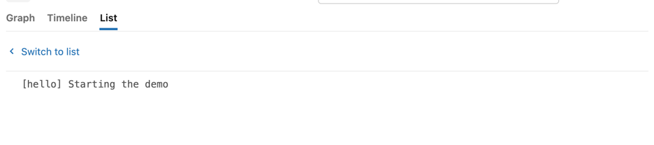
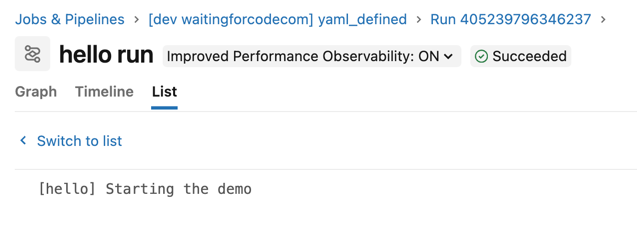
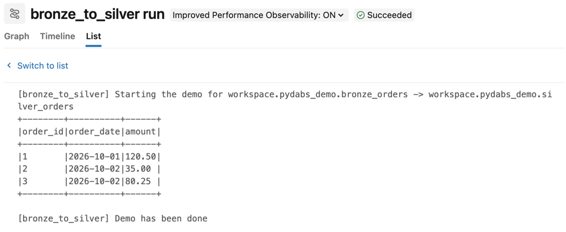
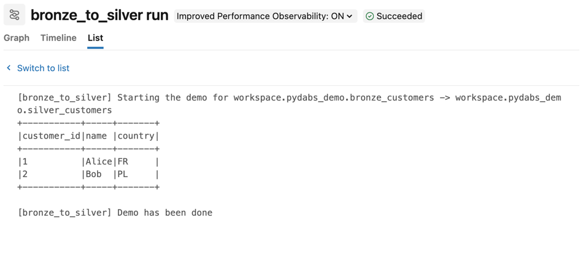

# Python Declarative Automation Bundles aka pydabs

## Prerequisites
1. Configure your Databricks workspace, if you haven't done it yet:
```shell
databricks configure
```

Set your workspace host in [databricks.yml](databricks.yml)

2. Create the demo schema and the bronze tables from the Databricks SQL Editor:
```sql
USE CATALOG workspace;
CREATE SCHEMA IF NOT EXISTS pydabs_demo;

CREATE TABLE pydabs_demo.bronze_orders (order_id INT, order_date DATE, amount DECIMAL(10, 2));
INSERT INTO pydabs_demo.bronze_orders VALUES
  (1, DATE'2026-10-01', 120.50),
  (2, DATE'2026-10-02', 35.00),
  (3, DATE'2026-10-02', 80.25);

CREATE TABLE pydabs_demo.bronze_customers (customer_id INT, name STRING, country STRING);
INSERT INTO pydabs_demo.bronze_customers VALUES
  (1, 'Alice', 'FR'),
  (2, 'Bob', 'PL');
```

## Demo 1 — Python-only resources and the virtualenv requirement

The [python_defined](resources/python_defined.py) job is declared in Python. The Databricks CLI loads it by running
the `resources:load_resources` function from the `python:` section of [databricks.yml](databricks.yml).

1. Remove the virtualenv and validate the bundle:
```shell
databricks bundle validate --profile personal_free_wfc
```
The validation should fail with 
> Error: failed to get Python interpreter path: can't find ".venv/bin/python3", check if virtualenv is created
> Found 1 error

2. Create the virtualenv and validate again:
```shell
uv sync
databricks bundle validate --profile personal_free_wfc
databricks bundle summary --profile personal_free_wfc
```
The validation succeeds and the summary lists the `python_defined` job:
```
Resources:
  Jobs:
    bronze_to_silver_customers:
      Name: [dev waitingforcodecom] bronze_to_silver_customers
      URL:  (not deployed)
    bronze_to_silver_orders:
      Name: [dev waitingforcodecom] bronze_to_silver_orders
      URL:  (not deployed)
    python_defined:
      Name: [dev waitingforcodecom] python_defined
      URL:  (not deployed)
```

3. Deploy the bundle and run the job:
```shell
databricks bundle deploy --target dev --profile personal_free_wfc
```

4. Open the Databricks console and run the `python_defined` job. You should see:



## Demo 2 — YAML and Python resources side by side
1. Ensure only the Python jobs are part of the bundle:
```shell
databricks bundle summary --profile personal_free_wfc
```

You should still see:
```
Resources:
  Jobs:
    bronze_to_silver_customers:
      Name: [dev waitingforcodecom] bronze_to_silver_customers
      URL:  https://dbc-d4ba7c54-6fba.cloud.databricks.com/jobs/580102647327586?w=7474657787001122
    bronze_to_silver_orders:
      Name: [dev waitingforcodecom] bronze_to_silver_orders
      URL:  https://dbc-d4ba7c54-6fba.cloud.databricks.com/jobs/83936965901256?w=7474657787001122
    python_defined:
      Name: [dev waitingforcodecom] python_defined
      URL:  https://dbc-d4ba7c54-6fba.cloud.databricks.com/jobs/996476076812320?w=7474657787001122
```

2. Add the YAML job: 
```shell
cp to_copy/yaml_defined.job.yml resources/
```

3. Run the summary again:
```shell
databricks bundle summary --profile personal_free_wfc
```

You should see a new job that is not deployed. It's our YAML job:
````
  Jobs:
    bronze_to_silver_customers:
      Name: [dev waitingforcodecom] bronze_to_silver_customers
      URL:  https://dbc-d4ba7c54-6fba.cloud.databricks.com/jobs/580102647327586?w=7474657787001122
    bronze_to_silver_orders:
      Name: [dev waitingforcodecom] bronze_to_silver_orders
      URL:  https://dbc-d4ba7c54-6fba.cloud.databricks.com/jobs/83936965901256?w=7474657787001122
    python_defined:
      Name: [dev waitingforcodecom] python_defined
      URL:  https://dbc-d4ba7c54-6fba.cloud.databricks.com/jobs/996476076812320?w=7474657787001122
    yaml_defined:
      Name: [dev waitingforcodecom] yaml_defined
      URL:  (not deployed)
````

4. Deploy the bundle and run the job:
```shell
databricks bundle deploy --target dev --profile personal_free_wfc
```

5. Go to the workspace and run the YAML job. It should execute successfully:




## Demo 3 — Unit tests vs databricks-connect

[pyproject.toml](pyproject.toml) defines three dependency groups:
* `bundles` with `databricks-bundles`, required by the CLI to load the Python resources
* `dev` (default) with `databricks-connect`
* `test` with `pyspark` and `pytest`

`dev` and `test` are declared as conflicting since `databricks-connect` and `pyspark` can't live in the same virtualenv.
Both include the `bundles` group, so the bundle remains deployable whatever environment is active.

1. Try to install the test dependencies on top of the default ones:
```shell
uv sync --group test
```

It should fail with:
```
error: Groups `dev` (enabled by default) and `test` are incompatible with the conflicts: 
{`pydabs-demo:dev`, `pydabs-demo:test`}
```

2. Switch to the test environment and run the [unit tests](tests/test_bronze_to_silver.py) on the local PySpark:
```shell
uv sync --no-default-groups --group test
uv run --no-default-groups --group test pytest
```

The test should run correctly.

3. Check that the bundle is still valid from the test environment:
```shell
databricks bundle validate --profile personal_free_wfc
```

You should still see the Validation OK.

4. Switch back to the default environment:
```shell
uv sync
```

## Demo 4 — Resources generated from metadata

The [bronze_to_silver](resources/bronze_to_silver.py) loader creates one job per table listed in `TABLES`. It's
registered as the second function in the `python.resources` section of [databricks.yml](databricks.yml).

1. Check the generated jobs:
```shell
databricks bundle summary --profile personal_free_wfc
```
The `Jobs:` section lists `bronze_to_silver_orders` and `bronze_to_silver_customers`, both created by the same function
in [bronze_to_silver.py](resources/bronze_to_silver.py):
```python
TABLES = ["orders", "customers"]


def load_resources(bundle: Bundle) -> Resources:
    resources = Resources()

    for table in TABLES:
        job = Job.from_dict(
            {
                "name": f"bronze_to_silver_{table}",
        # ...
        resources.add_resource(f"bronze_to_silver_{table}", job)
    return resources
```

2. Run the orders job from the UI. You should see:



3. Run the customers job from the UI. You should see:



## Demo 5 — Mutators adding tags

The [add_demo_tags](mutators.py) mutator is registered in the `python.mutators` section of
[databricks.yml](databricks.yml). It adds `blog` and `target` tags to every job of the bundle.

1. Show the tags of each job:
```shell
databricks bundle validate --output json --profile personal_free_wfc | jq '.resources.jobs | map_values(.tags)'
```
All four jobs have the tags, including the `yaml_defined` job declared in YAML.

2. Let's now modify the mutator to add a tag with the job name:
```
return replace(job, tags={**job.tags, "cost_center_job_name": job.name, "blog": "pydabs", "target": bundle.target})
```

3. Deploy the bundle:
```shell
databricks bundle deploy --profile personal_free_wfc 
```

It should fail with:
```
HTTP Status: 400 Bad Request
API error_code: INVALID_PARAMETER_VALUE
API message: 
The provided tag value ([dev waitingforcodecom] bronze_to_silver_orders) contains invalid character. The value must match the regular
expression ^[\d \w\+\-=\.:/@]*$.
```

4. Let's now modify the mutator to replace all special characters a tag with the job name:
```
    tag_job_name = re.sub(r'[^\d \w\+\-=\.:/@]', '_', job.name)
    return replace(job, tags={**job.tags, "cost_center_job_name": tag_job_name, "blog": "pydabs", "target": bundle.target})
```

5. Run the deploy again:
```shell
databricks bundle deploy --profile personal_free_wfc 
```

It should pass.

6. Show the tags of each job:
```shell
databricks bundle validate --output json --profile personal_free_wfc | jq '.resources.jobs | map_values(.tags)'
```

They should now have the new tag:
```
{
  "bronze_to_silver_customers": {
    "blog": "pydabs",
    "dev": "waitingforcodecom",
    "cost_center_job_name": "_dev waitingforcodecom_ bronze_to_silver_customers",
    "target": "dev"
  },
  "bronze_to_silver_orders": {
    "blog": "pydabs",
    "dev": "waitingforcodecom",
    "cost_center_job_name": "_dev waitingforcodecom_ bronze_to_silver_orders",
    "target": "dev"
  },
  "python_defined": {
    "blog": "pydabs",
    "dev": "waitingforcodecom",
    "cost_center_job_name": "_dev waitingforcodecom_ python_defined",
    "target": "dev"
  },
  "yaml_defined": {
    "blog": "pydabs",
    "dev": "waitingforcodecom",
    "cost_center_job_name": "_dev waitingforcodecom_ yaml_defined",
    "target": "dev"
  }
}
```

## Cleanup

1. Restore previous mutators file:
```shell
cp to_copy/mutators_default.py ./mutators.py
```

2. Remove YAML job from resources:
```shell
rm resources/yaml_defined.job.yml
```

3. Destroy the schema from the workspace:
```sql
DROP SCHEMA IF EXISTS workspace.pydabs_demo CASCADE;
```

```bash
databricks bundle destroy --target dev --profile personal_free_wfc
rm -rf .venv
```
