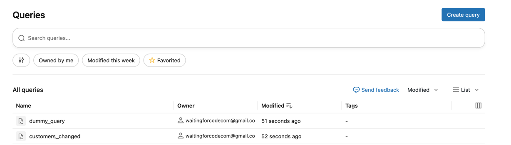
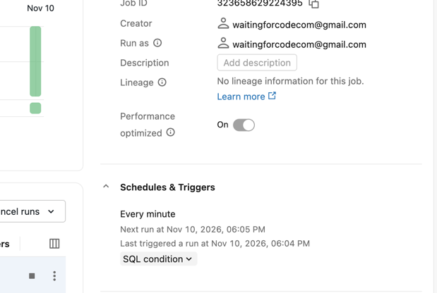
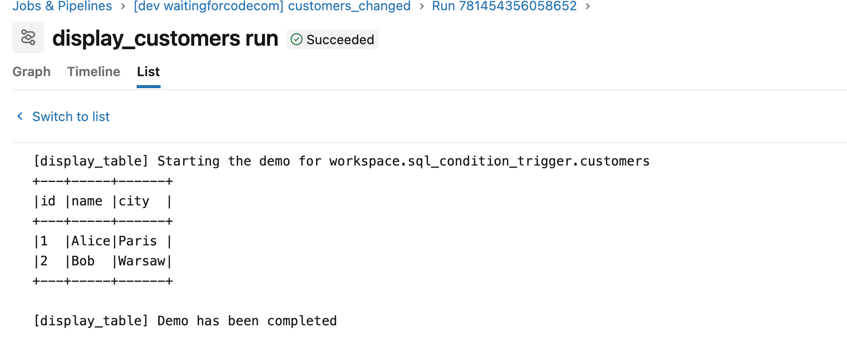
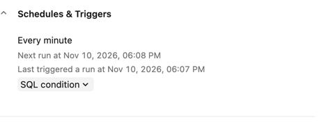
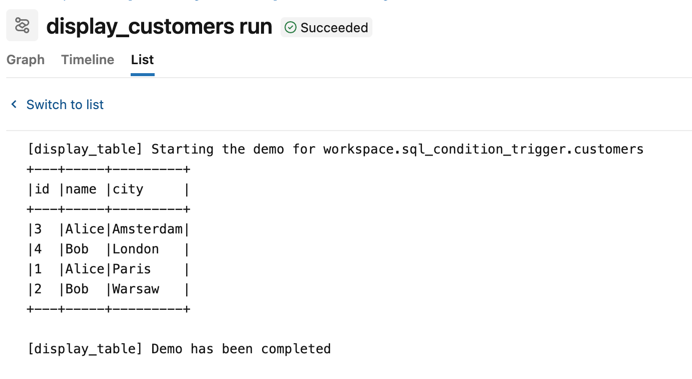

# SQL Condition triggers on Databricks — Python bundle

This is the Python bundle (PyDAB) flavour: the condition queries are created by the
[mutators.py](mutators.py) mutator during the deployment, so there is no script to run before it.
The [sql-condition-trigger](../sql-condition-trigger) bundle runs the same demo with a bundle script creating
the queries before the deployment.

## Prerequisites
1. Configure your Databricks workspace, if you haven't done it yet:
```shell
databricks configure
```

Set your workspace host in [databricks.yml](databricks.yml).

2. Authenticate:
```shell
BROWSER="/Applications/Google Chrome.app/Contents/MacOS/Google Chrome" databricks auth login --profile personal_free_wfc 
```

3. Install the dependencies and deploy the bundle:
```shell
unset DO_NOT_RUN_MUTATOR
uv sync
databricks bundle deploy --target dev --profile personal_free_wfc
```

> [!IMPORTANT]
> The mutator runs whenever the CLI loads the bundle, so `databricks bundle validate` creates (or updates) the
queries too. To avoid this, you need to create a variable `DO_NOT_RUN_MUTATOR=true` before running those commands.

The queries should be created:



4. Create the demo schema and tables from the SQL Editor:
```sql
CREATE SCHEMA IF NOT EXISTS workspace.sql_condition_trigger;

CREATE TABLE workspace.sql_condition_trigger.orders (id INT, amount DOUBLE);

CREATE TABLE workspace.sql_condition_trigger.customers (id INT, name STRING, city STRING);
```

## Demo 1 — Result value changes

The **customers_changed** job's condition returns a single cell, the total number of rows:
```sql
SELECT COUNT(*) FROM workspace.sql_condition_trigger.customers
```

1. Add some records to change the query result:
```sql
    INSERT INTO workspace.sql_condition_trigger.customers VALUES
      (1, 'Alice', 'Paris'),
      (2, 'Bob', 'Warsaw');
```

2. Open the **customers_changed** job. It should read the added rows:





3. Wait a few minutes. You should observe no new runs as the count doesn't change.

4. Add new rows:
```sql
INSERT INTO workspace.sql_condition_trigger.customers VALUES
  (3, 'Alice', 'Amsterdam'),
  (4, 'Bob', 'London')
```

5. Open the **customers_changed** job. The job should start the new execution and result all 4 customers:





## Cleanup

```sql
DROP SCHEMA IF EXISTS workspace.sql_condition_trigger CASCADE;
```

```shell
export DO_NOT_RUN_MUTATOR=true
databricks bundle run destroy_condition_queries --target dev --profile personal_free_wfc
databricks bundle destroy --target dev --profile personal_free_wfc
```