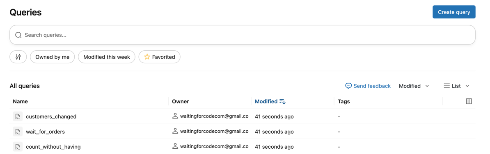
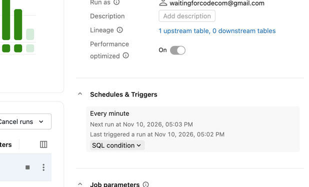
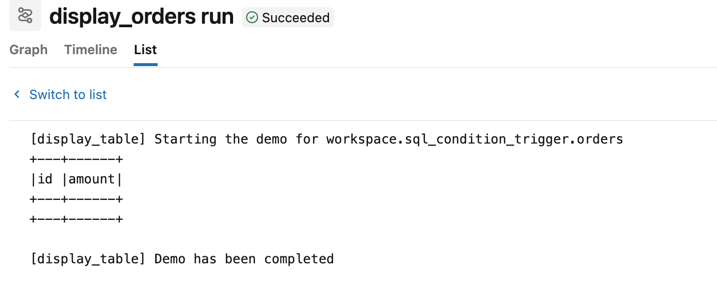
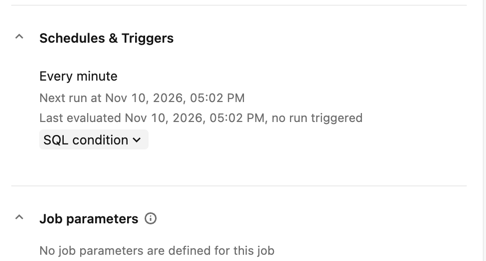
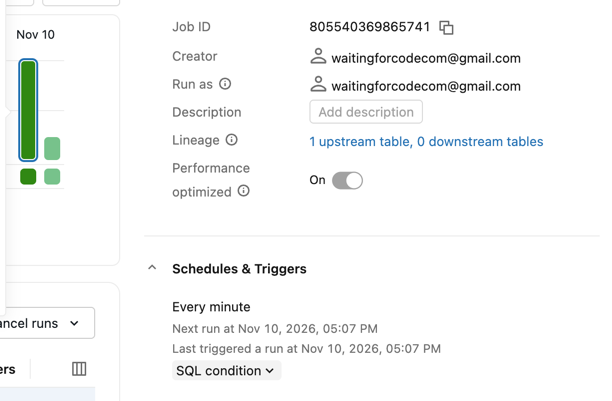
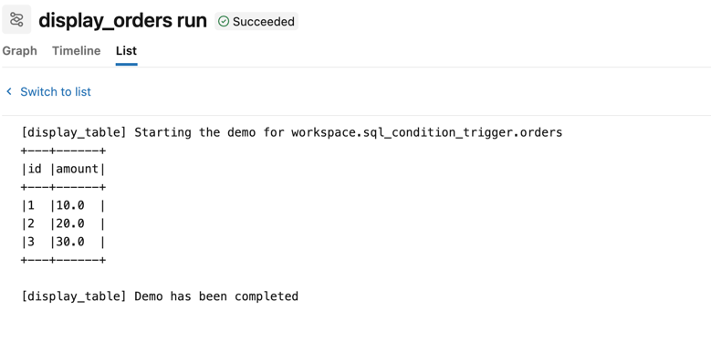

# SQL Condition triggers on Databricks — YAML bundle

This is the YAML bundle flavour: the condition queries are created by a bundle script before the deployment.
The [sql-condition-trigger-pydab](../sql-condition-trigger-pydab) bundle runs the same demo with a Python mutator
creating the queries during the deployment.

## Prerequisites
1. Configure your Databricks workspace, if you haven't done it yet:
```shell
databricks configure
```

Set your workspace host in [databricks.yml](databricks.yml).

2. Create the demo schema and tables from the SQL Editor:
```sql
CREATE SCHEMA IF NOT EXISTS workspace.sql_condition_trigger;

DROP TABLE IF EXISTS workspace.sql_condition_trigger.orders;
CREATE TABLE workspace.sql_condition_trigger.orders (id INT, amount DOUBLE);

CREATE TABLE workspace.sql_condition_trigger.customers (id INT, name STRING, city STRING);
INSERT INTO workspace.sql_condition_trigger.customers VALUES
  (1, 'Alice', 'Paris'),
  (2, 'Bob', 'Warsaw');
```

3. Authenticate:
```shell
BROWSER="/Applications/Google Chrome.app/Contents/MacOS/Google Chrome" databricks auth login --profile personal_free_wfc 
```

4. Create the SQL queries used by the trigger conditions. The bundle has no `queries` resource, hence the script
   defined in the `scripts` section of [databricks.yml](databricks.yml):
```shell
databricks bundle run create_condition_queries --target dev --profile personal_free_wfc
```

You should see 3 new queries in the _Queries_ tab: `count_without_having`, `wait_for_orders`, `customers_changed`.
The script also writes their ids to `.databricks/bundle/dev/variable-overrides.json` so that the deployment part 
picks them up:



We are using here the DAB script to share the execution context for a given target, for example the same SQL warehouse.

> [!IMPORTANT]  
> A `lookup: query:` variable can't be used here: `bundle run` resolves all lookups before running the script, 
> so it fails on the not yet existing queries. The lookup is the way to go when the queries are owned by another bundle.
> Error: failed to resolve query: wait_for_new_orders_query, err: ListQueryObjectsResponseQuery named 'wait_for_new_orders_query' does not exist


5. Deploy the bundle; the query id variables are read from the `variable-overrides.json` file:
```shell
databricks bundle deploy --target dev --profile personal_free_wfc
```

## Demo 1 — The COUNT pitfall

The **count_without_having** job's condition is:
```sql
SELECT COUNT(*) AS orders_count FROM workspace.sql_condition_trigger.orders
```

1. Run the **count_without_having** job.

2. A new run should have been created, even though the `orders` table is empty.
It's because the `COUNT(*)` always returns 1 row  and the trigger mode is _Query returns rows_. 





3. Pause the trigger to avoid the job running continuously (must click on Enable edits before).

## Demo 2 — Query returns rows with a HAVING threshold

The **wait_for_orders** job's condition is:
```sql
SELECT COUNT(*) AS orders_count FROM workspace.sql_condition_trigger.orders HAVING COUNT(*) >= 3
```

1. Run the **wait_for_orders** job; no run should be triggered as the table is empty.



2. Insert the orders and wait; the threshold of 3 orders should be reached and the job should trigger:
```sql
INSERT INTO workspace.sql_condition_trigger.orders VALUES (1, 10.0), (2, 20.0), (3, 30.0);
```

4. Shortly after, on the next condition evaluation, the job runs and displays the 3 orders.






5. Pause the job's trigger from the UI to avoid continuous evaluation (must click on Enable edits before).


## Cleanup

```sql
DROP SCHEMA IF EXISTS workspace.sql_condition_trigger CASCADE;
```

Delete the `count_without_having`, `wait_for_orders`, and `customers_changed` queries, and destroy the bundle:

```bash
databricks bundle run destroy_condition_queries --target dev --profile personal_free_wfc
databricks bundle destroy --target dev --profile personal_free_wfc
```

## Demo 3 — Result value changes

Let's move to the PyDAB queries definition for that demo. Open the PyDAB project: `sql-condition-trigger-pydab`
