# Table trigger demo

## Prerequisites
1. Configure your Databricks workspace, if you haven't done it yet:
```shell
databricks configure
```

Set your workspace host in [databricks.yml](databricks.yml)
 
2. Go to the SQL Editor of your workspace and set up the demo tables:
```sql
CREATE SCHEMA IF NOT EXISTS workspace.table_trigger_demo;
USE CATALOG workspace;
USE SCHEMA table_trigger_demo;

-- Tables for ANY_UPDATED trigger and ALL_UPDATED trigger
CREATE TABLE IF NOT EXISTS all_any_updated_src_a (id BIGINT, updated_at TIMESTAMP DEFAULT NOW()) TBLPROPERTIES (
  'delta.feature.allowColumnDefaults' = 'supported'
);
CREATE TABLE IF NOT EXISTS all_any_updated_src_b (id BIGINT, updated_at TIMESTAMP DEFAULT NOW()) TBLPROPERTIES (
  'delta.feature.allowColumnDefaults' = 'supported'
);

-- VIEW demo for both ANY_UPDATED and ALL_UPDATED
CREATE TABLE IF NOT EXISTS view_src_a (id BIGINT, updated_at TIMESTAMP DEFAULT NOW()) TBLPROPERTIES (
  'delta.feature.allowColumnDefaults' = 'supported'
);
CREATE TABLE IF NOT EXISTS view_src_b (id BIGINT, updated_at TIMESTAMP DEFAULT NOW()) TBLPROPERTIES (
  'delta.feature.allowColumnDefaults' = 'supported'
);

CREATE OR REPLACE VIEW v_view_src AS 
SELECT id, updated_at FROM view_src_a
UNION ALL
SELECT id, updated_at FROM view_src_b;

CREATE TABLE IF NOT EXISTS view_src_c (id BIGINT, updated_at TIMESTAMP DEFAULT NOW()) TBLPROPERTIES (
  'delta.feature.allowColumnDefaults' = 'supported'
);
CREATE OR REPLACE VIEW v_view_src_all AS 
SELECT id, updated_at FROM view_src_c;

-- min_time_between_triggers_seconds scenario
CREATE TABLE IF NOT EXISTS min_time_between_triggers_seconds_src (id BIGINT, updated_at TIMESTAMP DEFAULT NOW()) TBLPROPERTIES (
  'delta.feature.allowColumnDefaults' = 'supported'
);

-- wait_after_last_change_seconds scenario
CREATE TABLE IF NOT EXISTS wait_after_last_change_seconds_src (id BIGINT, updated_at TIMESTAMP DEFAULT NOW()) TBLPROPERTIES (
  'delta.feature.allowColumnDefaults' = 'supported'
);
```

3. Deploy the bundle:
```shell
BROWSER="/Applications/Google Chrome.app/Contents/MacOS/Google Chrome" databricks auth login --profile personal_free_wfc 
databricks bundle deploy --target dev --profile personal_free_wfc
```


## Demo 1 - ANY_UPDATED or ALL_UPDATED triggers
1. Open the _all_updated_trigger_ and _any_updated_trigger_ jobs in a separate tab of your browser.
2. From the SQL Editor add a new record to all_any_updated_src_a:
```sql
INSERT INTO all_any_updated_src_a (id) VALUES (1);
```
3. The _any_updated_trigger_ should start, and the trigger pane should detect new data:

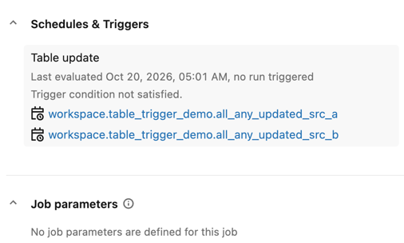
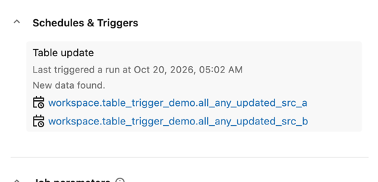

4. The _all_updated_trigger_ should still be idle:

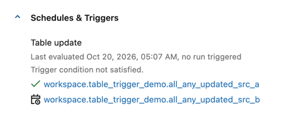

5. Add a record to the "b" table:
```sql
INSERT INTO all_any_updated_src_b (id) VALUES (10);
```

5. Go to _all_updated_trigger_. It should be running after evaluating the trigger:

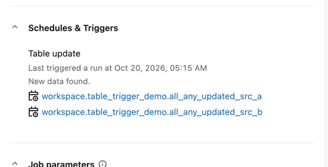

## Demo 2 - ANY_UPDATED or ALL_UPDATED for view
1. Open the _view_all_updated_trigger_ and _view_any_updated_trigger_ jobs in a separate tab.
2. From the SQL Editor add a new record to view_src_a:
```sql
INSERT INTO view_src_a (id) VALUES (1);
```
3. The _view_all_updated_trigger_ should start:

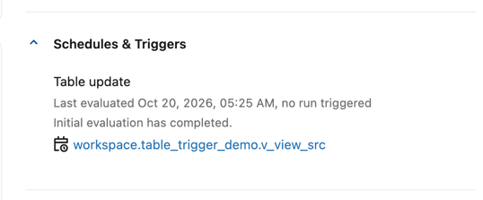
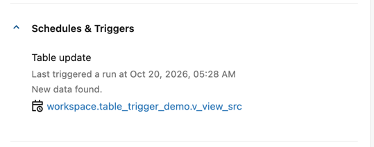

3. Insert again a new record to the `view_src_a` table:
```sql
INSERT INTO view_src_b (id) VALUES (2);
```

4. Go to the _view_any_updated_trigger_. You should observe it running despite only 
one table from the view being updated.

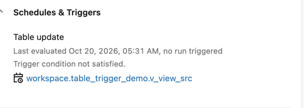
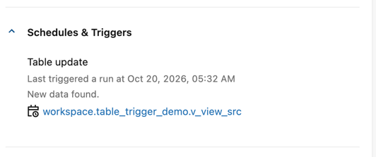

5. Change the trigger of the [view_all_updated_trigger.job.yml](resources/view_all_updated_trigger.job.yml) to:
```yaml
      trigger:
        table_update:
          table_names:
            - ${var.catalog}.${var.schema}.v_view_src
            - ${var.catalog}.${var.schema}.v_view_src_all
          condition: ALL_UPDATED
```

6. Deploy the bundle:
```shell
databricks bundle deploy --target dev --profile personal_free_wfc
```

7. Insert a row to the "b" table:
```
INSERT INTO view_src_b (id) VALUES (3);
```

8. Go to the _view_any_updated_trigger_. This time it should be idle:

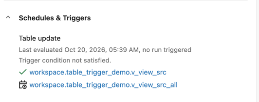

9. Insert a row to the "c" table used by the view_src_all view:
```
INSERT INTO view_src_c (id) VALUES (100);
```

10. Go to the _view_any_updated_trigger_. It should be running after evaluating the trigger:
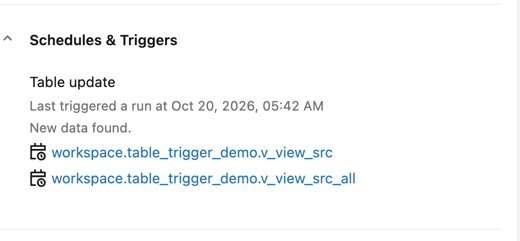


## Demo 3 - `min_time_between_triggers_seconds: 300`
1. Explain the [writer_min_time_demo.py](src/table_trigger/writer_min_time_demo.py)
* It runs **4 rounds**. Each round inserts one row and then sleeps for **30 seconds**.
Every `INSERT` is a separate Delta commit, so the table trigger sees four separate
table updates spaced about 30 seconds apart. That spacing is what the demo uses to
show how `min_time_between_triggers_seconds` works.
* table content after each insert:
```
| Step    | Committed at | Row added | Rows in table              |
|---------|--------------|-----------|----------------------------|
| Round 0 | `T0`         | `2000`    | 2000                       |
| Round 1 | `~T0 + 30s`  | `2001`    | 2000, 2001                 |
| Round 2 | `~T0 + 60s`  | `2002`    | 2000, 2001, 2002           |
| Round 3 | `~T0 + 90s`  | `2003`    | 2000, 2001, 2002, 2003     |
| End     | `~T0 + 120s` | –         | unchanged (final sleep, no write) |
```

2. Open the  _min_time_between_triggers_ job. It should be idle:

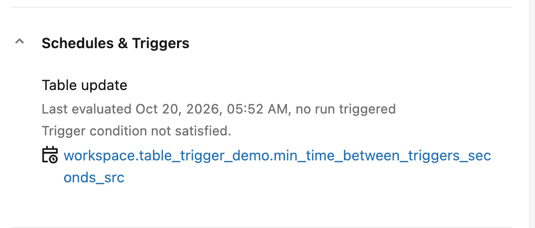

3. Run the _writer_min_time_demo_ job. The job writes new records every 30 seconds 4 times. 
Consequently, the _min_time_between_triggers_ job should start right after the first write but
wait 2 minutes after the first execution completes.

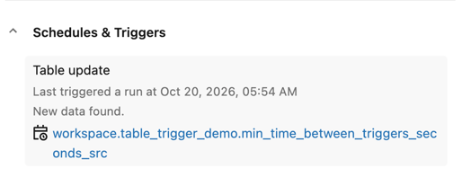

4. The writing job should still be running. The next trigger time for the reader should happen
approximately 2 minutes after the previous one:

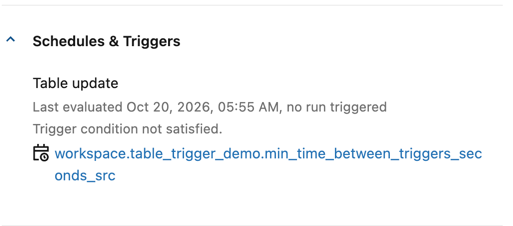

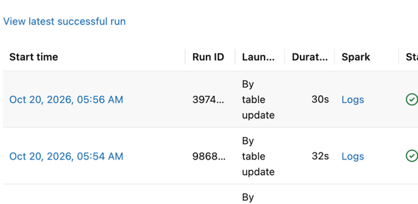

## Demo 4 - `wait_after_last_change_seconds: 60`
1. Run the _writer_wait_demo_ job. The job writes new record every 15 seconds 4 times. In total
it will be working for roughly a minute. Consequently, the _wait_after_last_change_ job
should start 60 seconds after the last write.

2. The _wait_after_last_change_ job should be waiting for the new data but it should detect changes 
a few seconds after starting the writer:

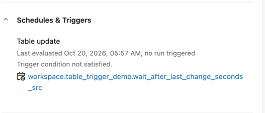
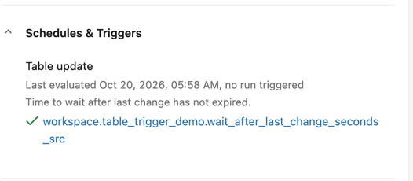

3. Finally, the job should run 1 minute after the last write:

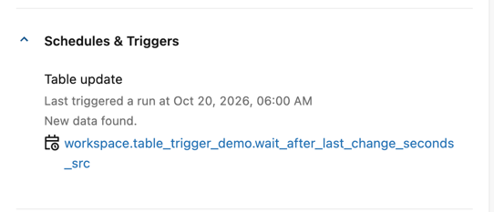

4. You can also check the table history and compare it with the trigger time of the job. The job
should start 1 minute after the last commit:
```sql
DESC HISTORY workspace.table_trigger_demo.wait_after_last_change_seconds_src
```

## Demo 5 - ALL_UPDATED and one of the trigger tables removed
1. Reopen the _all_updated_trigger_   jobs in a separate tab of your browser.
2. From the SQL Editor drop the table all_any_updated_src_a:
```sql
DROP TABLE all_any_updated_src_a;
```

3. The _all_updated_trigger_ should have now an error message:

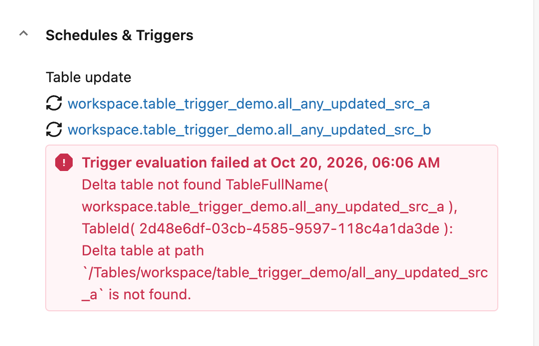

4. You should also get an email:

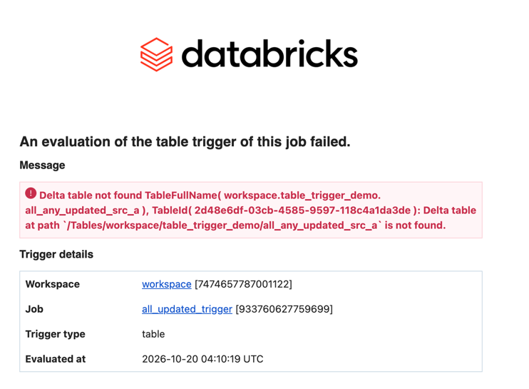

## Clean-up
1. Destroy the bundle:
```shell
databricks bundle destroy --target dev --profile personal_free_wfc
```

2. Go to your Databricks instance and delete a new volume:
```sql
DROP SCHEMA workspace.table_trigger_demo CASCADE;
```